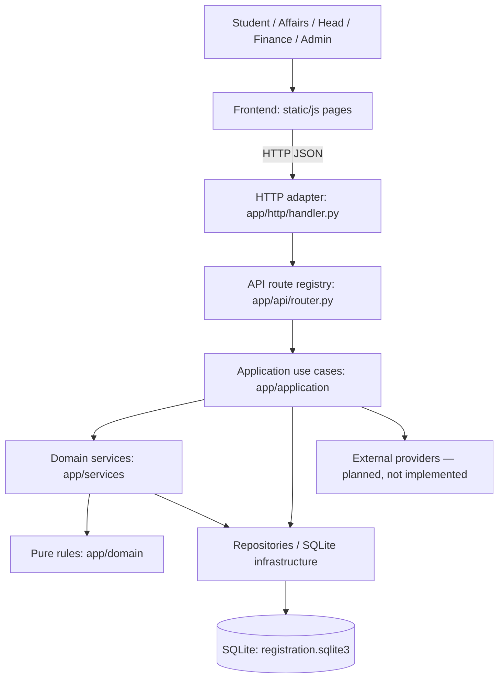

# Layered Architecture — UniGate / eng.rabe3

## هدف إعادة الهيكلة

التحويل من ملف خادم كبير وملف JavaScript واحد إلى حدود مفهومة، مع الحفاظ على مسارات API القديمة وبيانات SQLite وواجهات الأدوار الأربعة.

## مسؤوليات الطبقات

- **Frontend:** عرض عربي/إنجليزي، RTL، المظهران، التحقق الأولي فقط وتجميع المدخلات. لا يقرر صلاحية التسجيل النهائية.
- **HTTP Adapter:** استقبال الطلب، حدود حجم JSON، التحقق من Origin للطلبات الحساسة، جلسة المستخدم، تحويل الأخطاء إلى رموز HTTP، وخدمة ملفات الموقع. لا يكتب سجلات التسجيل بنفسه.
- **API Registry:** ربط `(method,path)` مباشرة بدالة واحدة من `app/application` من دون سلسلة if طويلة.
- **Application:** تنسيق استخدام الأدوار وصلاحياتها، أوامر شؤون الطلاب والمالية والأقسام والإدارة، وربطها بالخدمات. ما زالت بعض استعلامات SQL الخاصة بالحالات القديمة موجودة هنا؛ نقلها تدريجيًا إلى مستودعات متخصصة تحسين مستقبلي.
- **Services:** التسجيل الذري، فحص الأهلية، إعادة ترتيب الانتظار، تبديل الشعب، تقرير العلامات والخطة الأكاديمية.
- **Domain:** قواعد خالصة يسهل اختبارها دون قاعدة بيانات مثل حساب التداخل الزمني وسلم نقاط المعدل التجريبي.
- **Repository:** الاستعلامات المشتركة عن تسجيلات الطالب وحجز الشعب؛ لا تتخذ قرارات السماح بالعملية.
- **Infrastructure:** فتح SQLite، المعاملات، إنشاء الجداول والإضافات الخلفية، سجل التدقيق، والبيانات التجريبية.

## سيناريو 1 — حجز المقعد الأخير

`POST /api/register` → `app/application/enrollment.py` → `enroll_basket()` → `BEGIN IMMEDIATE` → فحص الدفعة/المتطلبات/التعارض/الساعات/السعة → `enrollments` + سجل الطلب + `audit` → `COMMIT` أو `ROLLBACK`.

حماية ثانية داخل القاعدة: trigger يرفض الكتابة المباشرة إذا كانت الشعبة ممتلئة، وtrigger يمنع التسجيل في شعبتين للمقرر نفسه.

## سيناريو 2 — تبادل شعبتين ممتلئتين

`POST /api/swap/request` → `app/services/swaps.py`: فحص ملكية الشعبة الحالية، وحدة المقرر، الصلاحية، التعارض، ثم حفظ الطلب بترتيب FIFO. إن وُجد طلب معاكس صالح، تنفذ المعاملة إزالة مؤقتة لصفَي التسجيل وإدخالهما بالقيم المتبادلة في **معاملة قاعدة بيانات واحدة**. الوسط غير مرئي لأي معاملة أخرى؛ الفشل يسترجع الحالتين الأصليتين.

لا تكشف واجهة الطالب اسم أو رقم طالب المقابل. طلب التبديل السابق يُعطّل عند سحب الطالب تسجيله.

## سيناريو 3 — قائمة انتظار مع أولوية الخريجين

`ordered_candidates()` تطبق الأولوية على من لديه حالة خريج و**المقرر مطلوب في خطة مسجلة ولم ينجح فيه**. لحماية غير الخريجين، تصبح الطلبات التي بلغت **24 ساعة** في الفئة المحمية، بغض النظر عن فئة الطالب. وعند التساوي تُراعى أسبقية الطلب. **مهلة 24 ساعة اختيار تجريبي يحتاج موافقة الجامعة.**

## قرار استخدام SQLite محليًا

اختيار مناسب للاختبار والتعلم، لا للمقياس الجامعي المذكور في السيناريو. يكتب SQLite بواسطة كاتب واحد في اللحظة الواحدة، ما يجعل `BEGIN IMMEDIATE` مناسبًا لتوضيح الذرية دون الادعاء بتحمل 12,000 مستخدم بنفس اللحظة. الإنتاج يحتاج تحليل حمل، وتحديد قاعدة موزعة/خادمية مناسبة، وقائمة انتظار ونشر متعدد العقد مع قياس فعلي.

## حدود الفصل الحالي

فصل المسارات كامل، وفصل خدمات العمليات الحرجة موجود. لكن بعض استعمالات SQL بقيت داخل Application لحفظ توافق النسخة ومخاطر أقل أثناء الانتقال؛ لذلك لا ندّعي Clean Architecture حرفيًا أو ضمانًا ضد أي تغيير مستقبلي. هناك حاجة لمستودعات لجميع الكيانات، ومهاجرات إصدار مستقلة، وإشراف تشغيلي ونظام رسائل قبل الإطلاق الفعلي.
